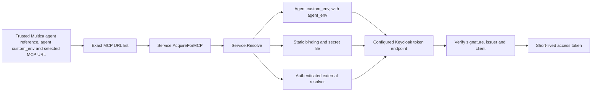

# Identity resolution

Controller-side module for issue #21. It resolves trusted Multica agent references,
reads credentials and verifies a Keycloak service-account access token. It has no background renewal loop. The
[OpenCode adapter](../opencode/README.md) calls it during persistent-controller
attempts for initial delivery and renewal.



## Static configuration

`ReadConfig` parses strict JSON; `New(config, controllerServer)` validates policy and creates the service.
Paths are absolute. The controller supplies the canonical Multica origin without a trailing
slash. Only the operator/controller supplies the reference to `Acquire`; workload
input is not authoritative. Missing bindings fail closed.
All agents authenticate with one `issuer` (realm). Static bindings enforce one
client per agent, including when an agent is available in multiple workspaces.
Different agents cannot share that client.

```json
{
  "version": 1,
  "issuer": {
    "url": "https://sso.example.com/realms/agents",
    "token_url": "https://sso.example.com/realms/agents/protocol/openid-connect/token",
    "jwks_url": "https://sso.example.com/realms/agents/protocol/openid-connect/certs"
  },
  "bindings": [{
    "workspace_id": "10000000-0000-4000-8000-000000000001",
    "agent_id": "20000000-0000-4000-8000-000000000001",
    "client_id": "agent-builder",
    "secret_file": "/run/secrets/agent-builder"
  }],
  "mcp": ["https://tools.example.com/mcp"]
}
```

Mount secrets only into trusted controller infrastructure, with restrictive file
permissions. No secret belongs in this JSON, Git, a task payload or a workload
mount. Files are bounded, read on each issuance and may be atomically replaced;
projected-secret symlinks are supported. A trailing newline is stripped. Only
regular, absolute-path files are accepted.

The binding may optionally include `"token": {"scopes": ["profile"],
"resource": "https://tools.example.com"}` when IAM needs those OAuth request
parameters. Omit it otherwise. This is an issuance request, not a resource catalog
or a tool permission list. Realm/client configuration controls the JWT's audience,
roles and groups. MCP validates audience, roles and access to each tool/resource.

The first issuer adapter supports Keycloak-style RS256 JWT access tokens with
`typ=Bearer` and the expected `azp`. It verifies signature, issuer, client, issuance
time and expiry; it does not compare the subject. The controller deliberately does
not validate audience or roles: it verifies the token is the client's, not access to
the recipient. Optional issuer `max_ttl_seconds` defaults to 300 and cannot exceed
3600; it rejects long JWTs, without changing IAM's token lifespan. Opaque tokens and
other issuer claim conventions require another adapter.

## Agent env

With `"agent_env": true` (ADR 0022) the agent's `custom_env` from the claim names its
client: `IDP_IAM_CLIENT_ID` and `IDP_IAM_CLIENT_SECRET`. Both present take precedence
over bindings or the resolver; neither falls back to them; one alone or an invalid
value denies. `agent_env` may be the only source. The adapter passes the claim's
`custom_env` on every issuance, so renewal uses the attempt's snapshot. `env_allow`
cannot name either variable. Multica stores the secret in plain text and native
runtimes of the agent receive it as process env.

## MCP delivery rules

`mcp` lists exact approved URLs. `AcquireForMCP` rejects unlisted URLs before contacting
the token endpoint. Matching does not use prefixes, connection names or wildcard domains.
Duplicate URLs are rejected. No list means no approved MCP delivery. `mcp_anonymous`
approves exact URLs the relay reaches without any token; a URL is in one list only.

The caller must supply a connection selected by trusted Multica task data. The list
approves identity delivery; it does not add MCP connections, connect to servers or
set tool permissions. The OpenCode adapter applies it to trusted claim selections and rejects
conflicting credentials.
`Acquire(ref, env)` obtains identity without selecting a destination; adapters must use
`AcquireForMCP(ref, env, selectedURL)` for MCP delivery.

## External configuration and wire contract

Replace `bindings` with the following block; there is no fallback between bindings and the resolver:

```json
{
  "external": {
    "url": "https://identity.example.com/v1/resolve",
    "bearer_file": "/run/secrets/identity-resolver"
  }
}
```

Keep the `issuer` and `mcp` list locally. The service must authenticate the controller
and authorize its binding access. Its reply names the client; it cannot supply
token/JWKS URLs. The resolver owns consistency of external agent-to-client bindings,
including the one-agent-per-client rule. It may return
the same optional `token` issuance parameters as a static binding; malformed
parameters are rejected and cannot change the token/JWKS endpoints.

The controller sends POST with its own Bearer credential and this JSON:

```json
{"version":1,"agent":{"server":"https://multica.example.com","workspace_id":"10000000-0000-4000-8000-000000000001","agent_id":"20000000-0000-4000-8000-000000000001"}}
```

A successful HTTP 200 response echoes that exact reference:

```json
{"version":1,"agent":{"server":"https://multica.example.com","workspace_id":"10000000-0000-4000-8000-000000000001","agent_id":"20000000-0000-4000-8000-000000000001"},"client_id":"agent-builder","client_secret":"<secret>"}
```

Unknown fields, wrong versions/references, empty credentials, unavailable services
and non-200 replies fail closed. Resolver credentials are re-read each time.
HTTP requests have a ten-second limit and 64 KiB response bound. Redirects and
proxy environment variables are disabled; HTTPS is required unless the operator
explicitly enables `allow_http` for an isolated fixture. Raw remote errors and
credentials are never included in module errors. Credentials/tokens reject JSON
serialization and redact formatting; delivery uses the explicit `Bearer()` method.

## Walk through the code

1. Static rotation: `Service.Acquire` → `Service.Resolve` →
   `staticResolver.Resolve` → `readSecret` → `issuer.issue`. Replace a secret file;
   the next issuance reads the replacement.
2. External binding: `remoteResolver.Resolve` authenticates and checks the echoed
   reference; `Service.Resolve` rejects a reply without a valid client.
3. Agent env: `Service.Resolve` takes both `IDP_IAM_*` values before the resolver.
4. MCP delivery: `Service.AcquireForMCP` checks the exact selected URL before
   issuance. Unapproved URLs never reach the token endpoint.
5. Wrong client: `issuer.issue` rejects a correctly signed token for another client. Audience and role authorization stay with MCP. No token is returned to a delivery adapter.

Run `go test -race ./internal/identity` for contract/adversarial tests and
`./scripts/test-identity.sh` for every credential source against real Keycloak.
Attempt grants and ongoing renewal are exercised separately by
`VERIFY_OPENCODE=1 ./verify.sh`.
