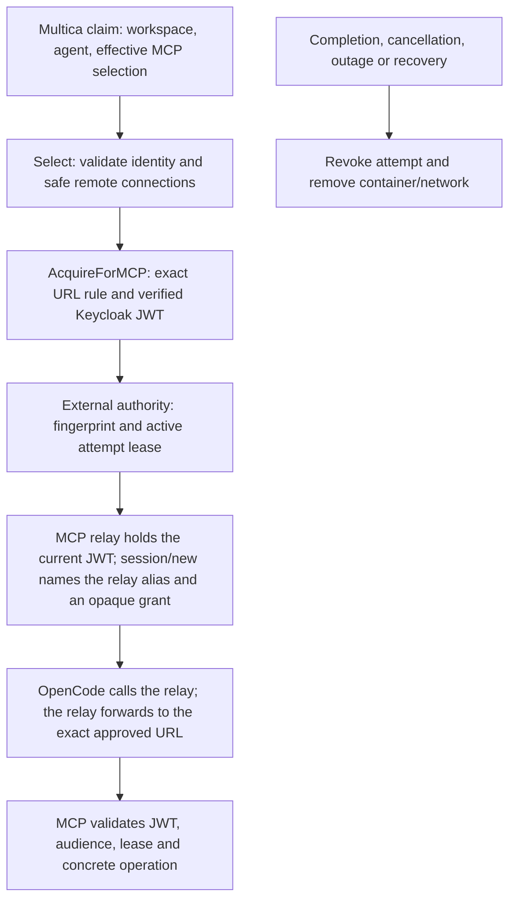

# Experimental OpenCode MCP adapter

The persistent controller's opt-in OpenCode path projects trusted Multica task context, drives `opencode acp` over the Agent Client Protocol (ADR 0023) and carries selected MCP connections through a controller relay that rotates verified identity during one disposable attempt. Images are user-owned; the controller
inspects the digest-pinned image once at startup against the [image contract](#image-contract). Optional inference uses the workspace-key relay from ADR 0012. The [conformance](#conformance) section lists pinned versions, verified behavior with its tests and explicit limitations.

## Configuration

Start from `deploy/controller.example.json`; set a digest-pinned OpenCode-compatible
image and add `opencode` using `deploy/opencode.example.json`. Mount its identity
configuration, static/external secret files and authority credential **only into the
controller**, for example through a local Compose override. The base Compose manifest
has no corporate identity mounts. Keep all actual configuration outside Git.

`identity_file` requires `mcp_relay` (`listen`, `url`): attempts reach selected MCP only through it, with an opaque per-attempt `mcp_relay_` credential, and access tokens stay in the controller. Add the controller to the template `peers` with the alias named by `url`; MCP services belong on the control network, not the template. The relay forwards streamable HTTP (POST, SSE responses, the GET stream, `Mcp-Session-Id`) to the exact approved URL, refuses redirects, strips `WWW-Authenticate` and cancels open streams at cleanup; legacy SSE endpoints and URLs with a query or encoded path are refused.

`network` names an operator-owned internal bridge template containing exactly the named `peers`. Each attempt gets a new internal network with only those peers and its own container. Place Multica, IAM, resolver, MCP services and credential stores on a separate control network. Only the controller and approved gateway services may be peers. Enforce host/metadata and destination policy outside Docker; internal bridges do not establish a production adversarial egress boundary. Do not attach untrusted workloads/services to the template. Concurrent attempt containers never share a network.

The default command is `opencode acp` in `/workspace/work`. An operator-supplied command must speak ACP on stdio and may read `/workspace/opencode.json`; only controller configuration chooses that command. Images may include their own tools and credential-free provider configuration; [tool bundles](#image-contract) add tools without rebuilding the image. No inference/provider credential is permitted in an image or command; managed inference uses `inference_file` and `inference_relay`; see [`internal/inference`](../inference/README.md). The fixture supplies a mock provider from trusted test configuration solely to exercise tool turns without a subscription.

## Image contract

Users build images in their own CI; the controller never builds Dockerfiles or pulls.
At startup it runs `ImageProbe` offline within attempt limits and fails closed
with every incompatibility. The optional base is an official image from
[`images.txt`](images.txt) (Alpine), unchanged or extended with `FROM`; no project
base is published. `examples/agent-image/debian.Dockerfile` shows an unrelated base
with the released glibc OpenCode build. A compatible image:

- matches the Docker engine platform (`linux/amd64` or `linux/arm64`) and declares no volumes;
- has `/bin/sh` with `sleep`, `mkdir`, `cat`, `chmod`, `mv`, `tar` (with the relay), and `opencode` on `PATH`
  reporting a verified version (`Supported` in `image.go`); `/opt/multica-sandbox` is reserved;
- ships no `/etc/opencode`, `/opencode.json[c]` or `/.opencode`, which OpenCode merges
  over the projected configuration, and no `OPENCODE_*` or `MULTICA_*` image `ENV`;
- runs as uid 65532 on a read-only rootfs without network: `HOME`, `XDG_*` and `TMPDIR` (`/workspace/tmp`) are in the executable `/workspace` tmpfs, `/tmp` is `noexec`; install tools at build time;
- carries no secrets: everything in the image is visible to the agent.

`resources` (`cpus`, `memory`, `pids`, `nofile`, `workspace_size`, `tmp_size`, `shm_size`; defaults 2, `4g`, 1024, 4096, `1g`, `256m`, `64m`; under sysbox `pids` 2048, `nofile` 65536, `tmp_size` `512m`) bound every attempt and the image inspection; swap equals memory and the created container must match them exactly. The upstream daemon sets no limits; size them for the builds agents run. `pool` (`cgroup_parent`, `cgroup_dir`, optional `attempt_memory_max`, `max_pressure`, `max_working_set`) replaces the memory limit with a host slice shared by attempts, with swap; claims wait while it is under memory pressure, and an attempt killed for memory fails once with `agent_error.process_failure` (ADR 0020, `examples/sysbox-host`). `runtime: sysbox-runc` gives each attempt its own Docker engine (ADR 0019): the image also provides `dockerd`, `containerd`, `runc` and `iptables`, the helper is required, and `dind` (`registry_mirrors`, `insecure_registries`, `ready_timeout`, `testcontainers_ryuk_disabled`) configures the engine. Without network, inner pulls reach Docker Hub only through a pull-through mirror peer; the agent uses `/var/run/docker.sock` as uid 65532.
Entrypoint, command, `USER` and `HEALTHCHECK` are ignored. The version check is a
compatibility contract, not a security boundary: host policy holds for any image.

Tool bundles: top-level `tools` lists `{name, image, path?, check?}` (ADR 0002; `examples/tool-bundle`). Each digest-pinned, preloaded bundle is mounted read-only at `/opt/multica-sandbox/tools/<name>`; its `path` directories (default `bin`) follow the `multica` CLI and precede the image `PATH`, in declared order. Startup rejects missing `path` entries, commands provided twice and reserved commands (`opencode`, `multica`, `sh`, `sleep`, `mkdir`, `cat`, `chmod`, `mv`), then runs each `check` argv (first element relative to the bundle) offline in the agent image. Build bundles self-contained (static or with their own loader) and relocatable: a glibc binary on a musl image fails with `ENOENT`, and a shell then silently runs the image command of the same name. Bundles are compatibility inputs; host policy holds for their contents, including setuid files.

Agent environment: `env_allow` lists up to 32 agent `custom_env` names passed to attempts, like the upstream daemon passes all of them; names the controller or image owns (`MULTICA_*`, `OPENCODE_*`, `XDG_*`, `GIT_*`, `GH_*`, `GITLAB_*`, `SSL_CERT_*`, `LD_*`, `HOME`, `PATH`, `TMPDIR`, proxy variables, the process basics and the controller-only credentials `INFERENCE_BASE_URL`, `INFERENCE_API_KEY`, `IDP_IAM_CLIENT_ID`, `IDP_IAM_CLIENT_SECRET` of ADR 0022) are rejected at startup, values with line breaks or over 4 KiB are dropped, and controller values win. Values stay redacted in the controller. `custom_args` are never applied: they are flags of other agent CLIs.

## Multica API relay

`multica_relay` (`listen`, `url`) enables ADR 0014: the controller relays the upstream `multica` CLI to its configured Multica origin, replacing a per-attempt `mat_relay_` credential with the claim's `mat_` token held only in memory. Add the controller container to the template `peers` with the alias named by `url`; Multica stays on the control network. `multica_cli` names the CLI artifact built by `deploy/multica-cli.Dockerfile` from the pinned revision; preload it by digest like the agent image. The controller mounts it read-only at `/opt/multica-sandbox/multica` (Docker image mount, ADR 0002) first on `PATH`, so image copies or `PATH` cannot shadow it, and requires `multica` to resolve to it at startup; images need no `multica`. Issue and web chat tasks then receive the upstream prompt, an `AGENTS.md` brief with the project context, `.multica/project/resources.json` for project tasks, the `MULTICA_*` environment, in-container `bash`/file tools and the claim's skills in OpenCode's global skill root (ADR 0018). Grants end at cleanup or controller restart; credential-minting, daemon and account routes are denied. With `helper`, `git_relay` and `git_file`, the unchanged `multica repo checkout` works inside attempts on a workdir volume, plain `git push` publishes branches through the Git relay, and with `forge_relay` the unchanged `gh pr create` opens pull requests ([`internal/repo`](../repo/README.md)). `sessions` (`ttl`, `max`, optional `interval`, `grace`) with the helper retains issue and web chat workdirs for resume (below).

## External authority adapter

`internal/attempt` POSTs authenticated version-1 JSON to one configured endpoint.
It disables redirects/proxy environment, re-reads the controller-only bearer file
and requires HTTP 204. HTTPS is required outside explicit isolated fixtures. The
authority is external; this repository contains only a fixture implementation.
Without `identity_file` agents selecting MCP are refused; without the optional `authority` MCP tokens stay unregistered until expiry (ADR 0009).

`renew` includes `controller`, the dispatch-fenced `attempt`, `server`,
`workspace_id`, `agent_id`, `task_id`, `mcp_url`, SHA-256 `token_hash`, and epoch-second
`expires_at`. It contains no bearer JWT. Inference grants live in the controller relay, not here. The authority authenticates the controller,
validates references/recipients, and registers or renews a bounded active grant.
`revoke` ends every fingerprint for an attempt; `recover` ends the controller's
previous grants. Both must be idempotent. Ended attempts cannot be re-enrolled and
a fingerprint cannot move between attempts. Every receiving MCP operation checks
JWT identity/audience and an active unexpired grant, including concrete resources;
`tools/list` must expose only authorized tools. The authority must enforce these
rules independently and fail closed on loss of state. In-flight operation cancellation
is outside this contract. A stopped renewal loop alone does not revoke a JWT.

## Native reporting

The adapter drives `opencode acp` with [`coder/acp-go-sdk`](https://github.com/coder/acp-go-sdk) like the upstream OpenCode ACP backend (`server/pkg/agent/opencode_acp.go`): a bidirectional exec, no client filesystem or terminal, and permission requests rejected once, so the projected configuration stays the permission authority. Session updates map to Multica by `toolCallId`: joined text and reasoning chunks, `tool_use` when a tool starts with its input and `tool_result` when it ends, with the upstream 8 KiB UTF-8 preview; child sessions keep tool calls and drop text. Messages go to Multica in 500 ms best-effort batches with ordered `seq`. `idle_watchdog` (default `10m`, upstream's) stops a silent agent and pauses while a tool runs. `stopReason` decides the outcome with upstream wording; an agent that exits without answering the prompt is a retryable stream cut, a turn with no text, tool or usage fails, and native error bodies, which quote provider responses, are withheld: only the error name is reported, or the HTTP status the inference relay saw from the gateway (2.x rate limits and refused provider credentials otherwise map to 429 and 401). Cancellation sends `session/cancel` before the exec is torn down. Usage comes from the prompt response on 2.x and from the turn's messages in `opencode export` on 1.x, whose prompt usage covers only the last model call; it is reported once as provider `opencode` with the applied model or `unknown`. The native session ID is reported mid-flight and on completion; without a retained workdir it carries `session_rollout_missing`, so Multica never resumes it. With `sessions` (and the helper), upstream issue and web chat tasks keep one workdir volume per (controller, workspace, agent, issue or chat session), reported as `work_dir`, holding the session database (`OPENCODE_DB`). A follow-up continues `prior_session_id` with `session/load`, ignoring the replayed history, only when `prior_work_dir` names that pre-existing volume; otherwise it starts fresh with the upstream continuity notice, which `prior_session_resume_unavailable` also adds. A refused load starts a fresh session once in the same process and reports `retired_session_id`. Resumed comment tasks get upstream's warm hints from the claim's issue-state and comment deltas; claims advertise `coalesced-comments-v1`, and coalesced comments are embedded with per-thread reply targets. Delta shapes the server would not send keep the cold reads; malformed coalesced comments reject the claim. Web chat tasks (ADR 0017) get upstream's chat prompt, brief and transcript continuity notice and the claim's repositories; malformed chat fields reject the claim; channel-backed chats keep the legacy prompt. A second writer waits 15 s, then gets a per-attempt volume. `ttl` after last use and a `max` count bound retention; they are collected at startup and after session runs, and restart reconciliation keeps session volumes. A sweep at startup and every `interval` (default `2h`) also removes, like upstream daemon GC (`GetIssueGCChecks`), volumes of issues done or cancelled (lifecycle category `done`/`closed`, else legacy status) and last updated more than `grace` (default `24h`) ago. It asks each workspace only about its own volumes' issues, in batches of 500, with the controller's Multica client. Failed checks, missing or unknown issues and volumes used since the check stay; busy volumes are never removed. Unlike upstream, inaccessible issues are not orphan-collected by age: the idle TTL bounds them.
Complete/fail follow cleanup and use a durable at-least-once queue. Each reported attempt logs one `attempt finished` JSON event (ADR 0025): task, workspace, agent, kind, status and reason with the safe text Multica receives, prepare/run/total seconds, session continuity, model, effort, tokens, attempt `memory.peak` (Linux 5.19+) and session; prompts and output stay out.

## Conformance

Supported means this path only: persistent controller, Docker projected backend,
native OpenCode. Evidence is fixture-based for the pinned stack, not production
certification. Pins: Multica v0.5.2 `d45aba1cd7582bef9210b921bbb7dc198b48e1ee`
(unmodified); OpenCode 1.18.34 (`aec0b9a6`), 1.18.35 (`53d1eabb`) and 2.2.2 (`098aa7fd`), official images in `images.txt`; ACP Go SDK 0.13.5; LiteLLM v1.104.0 with
Postgres virtual keys; Keycloak 26.8.0; MCP Go SDK 1.8.0; go-oidc 3.21.0; Docker
Engine 29.2.1 (runc, cgroup v2, `linux/arm64`; `amd64` is unverified). Reproduce with `MULTICA_SOURCE=<checkout>` and
`VERIFY_CONTAINERS=1 VERIFY_SERVICE=1 VERIFY_OPENCODE=1 VERIFY_INFERENCE=1 VERIFY_IDENTITY=1 ./verify.sh`;
`OPENCODE_IMAGE=<listed or candidate image> ./scripts/test-opencode.sh` repeats the MCP rotation on another release.

| Verified behavior | Evidence (flags) |
| --- | --- |
| Trusted context only; safe repository references | `projection_test.go`; `claim-secret-sentinel` in `integration/managed_mcp_test.go` (SERVICE, OPENCODE) |
| Project resources: Project Context section and `.multica/project/resources.json` byte-identical to v0.5.2 output, for issues and web chats; `github_repo` resources in every upstream URL form (https, http, ssh, git, scp-like) only through the claim repositories' checkout and Git relay, no new attempt variables; long titles, labels and refs, backticks and newlines accepted and kept on their line; only shapes the server never sends (no project, non-UUID IDs, invalid JSON, out-of-claim repos, credential URLs, `local_directory` without daemon), more than 256 resources, over 64 KiB and `local_directory` pinned to this controller rejected; a real project claim | `project_test.go`; `internal/repo/relay_test.go`; `projected_test.go` (CONTAINERS); `integration/project_test.go` (UPSTREAM) |
| ACP turn: tool visible with input while running, joined text, child sessions, `stopReason` outcomes, stream cut, withheld errors, `session/cancel`, `session/load` replay ignored, refused load fresh once, no client filesystem/terminal, permission requests rejected, usage per version | `acp_test.go`, `events_test.go`; `examples/acp-spike`; `integration/adapter_reporting_test.go` |
| Upstream failure reasons, durable reports, replay before recovery | `internal/multica/outbox_test.go`; `integration/retry_test.go` (UPSTREAM) |
| Cancellation revokes and cleans up before the terminal callback | `adapter_test.go`; `integration/upstream_test.go`; fixture `cancelled` (OPENCODE) |
| Restart: old attempts removed, authority `recover`, relay grants lost | `integration/service_recovery_test.go`; `rotation_lease.go`; `restartFailsClosed` |
| Concurrent workspaces; 100-workspace fairness | `examples/identity-mcp/rotation.go`, `inference.go`; `integration/fleet_test.go` |
| MCP JWT rotation across expiries through the relay on 1.18.35 and 2.2.2, exact recipient; opaque per-attempt credential, unselected alias, forged, expired and revoked grants denied, streams cancelled, `WWW-Authenticate` withheld; legacy SSE and unrelayable URLs refused | `mcp_test.go`, `projection_test.go`; `rotation.go` (OPENCODE); `internal/identity` tests |
| Issuer/resolver outage; ended JWTs denied before expiry | `examples/identity-mcp/rotation_failures.go` (OPENCODE) |
| 15 s outage lease; no fingerprint move or re-enrollment | `examples/identity-mcp/rotation_lease.go` (OPENCODE) |
| MCP checks resource/attempt/workspace per call | `examples/identity-mcp/scenario.go` (IDENTITY) |
| Multica relay: opaque credential, token-minting denied; controller CLI is a read-only image mount first on `PATH`, image `multica`/`PATH` cannot shadow it; writes, extra or altered mounts, unpinned, absent and wrong-revision artifacts rejected | `internal/relay` tests; `policy_test.go`; `image_test.go`, `projected_test.go` (CONTAINERS); `integration/multica_relay_test.go` |
| Workspace keys: spoofing, cross-workspace, forged/ended, key change, stream revocation, 403/422 without substitution | `internal/inference`, `internal/relay` tests; `inference.go` (INFERENCE); `integration/inference_test.go` |
| No `mat_`/gateway/provider key in attempt env/files, logs, transcript, comments, results | `integration/multica_relay_test.go`, `inferenceCredential` |
| Tool bundles: read-only, declared `PATH` order; reserved, duplicate and missing entries, failing checks and escaping paths rejected; setuid cannot elevate; the agent runs a bundled `jq` | `tools_containers_test.go`, `image_test.go` (CONTAINERS); `integration/multica_relay_test.go` |
| User images: unsupported version (1.x and 2.x version output), OpenCode config overrides, reserved `ENV`, volumes and platform rejected; `USER`, setuid and entrypoint cannot change identity | `image_test.go`, `create_failure_test.go` (CONTAINERS) |
| Bases: Debian with the newest released OpenCode completes the relay, inference and restart path; every `images.txt` image completes the relay unchanged, and references elsewhere must be listed; none contains `multica`; attempt probes run from a sidecar, not image tools | `examples/agent-image/debian.Dockerfile`; `integration/multica_relay_test.go` (SERVICE, OPENCODE); `image_test.go` |
| Repository checkout and push: unchanged CLI clones a claim repository through the Git relay on the task branch; upstream kept/fresh/ref/path semantics; plain `git push` publishes it with the configured identity and the upstream co-author trailer, which follows a mid-attempt setting change; unchanged `gh pr create` opens a pull request over GraphQL through the forge relay; host password absent from attempt, volume and logs; unlisted repositories, Multica credential on Git, foreign workdir and ended fetch/push grants denied; GraphQL from other workspaces, with Host/SNI mismatch or after revocation denied; volume owned by the attempt user, removed at cleanup and restart | `internal/repo` tests; `workdir_test.go` (CONTAINERS); `integration/multica_relay_test.go` (SERVICE, OPENCODE) |
| Session resume: a comment follow-up resumes the retained native session in the same workdir with upstream warm hints (comment count, changed issue fields, multi-thread replies); every hint branch, continuity gate and malformed delta; a missing session is retired and replaced fresh; other agents, issues and workspaces get other volumes; concurrent writers, forged `prior_work_dir` and unlabelled volumes are refused; session cap and TTL; the periodic sweep removes sessions of done or cancelled issues per workspace and keeps unknown, failed, recent and busy ones; restart keeps only labelled session volumes; no credential in the volume | `session_test.go`; `projection_test.go`; `sessions_gc_test.go`; `internal/multica/issues_test.go`; `sessions_test.go` (CONTAINERS); `integration/issue_gc_test.go` (UPSTREAM); `integration/multica_relay_test.go` (SERVICE, OPENCODE) |
| Skills: upstream slugs, frontmatter and visibility (differential fuzz against upstream); escaping, duplicate and oversized skill files rejected; tree extracted under the fixed root as the attempt user; brief Skills and Sub-issue sections; chat selection; every `images.txt` image discovers the global root (1.x lists the skill; 2.x loads the root, and the spike saw the skill in its system prompt) | `skills_test.go`; `resources_test.go`; `projected_test.go`, `skills_containers_test.go` (CONTAINERS) |
| Web chat: upstream chat prompt, brief and transcript continuity notice byte for byte; a second web chat message resumes the first message's session in the chat's retained workdir after a transcript read; channel chats keep the legacy prompt; malformed chat claims rejected; other chats and an issue with the same ID get other volumes; forged `prior_work_dir` refused | `chat_test.go`; `sessions_test.go` (CONTAINERS); `integration/multica_relay_test.go` (SERVICE, OPENCODE) |
| Hostile workload: no capabilities/sockets/secrets/metadata, limits, no route, external DNS through the embedded or a direct resolver (checked against a resolving control), no host address on the attempt network, IPv6 or other attempt | `internal/docker/backend_test.go`, `projected_test.go` (CONTAINERS) |

Deployment-owned, verified only as integration contracts: production egress policy,
attempt-network TLS, host and kernel hardening (gVisor/Kata/Sysbox); workload
attestation and the attempt authority (this repository ships fixture plumbing); MCP
tool/role/resource authorization; gateway grants, budgets and routing. Revocation denies
new MCP operations but does not cancel MCP work in flight; relay streams are cancelled.
While the controller is down no backend deadline exists; Kubernetes deadlines and
distributed ownership are #6.

Limitations: verified OpenCode releases only (`images.txt`); `scripts/opencode-release.sh` admits a new release after its conformance; other agents need their own conformance. ACP usage, child-session and tool-name details are observed behavior, not documented contracts. Resume needs `sessions`; channel chats and attempts without the helper start fresh; squad-leader reply variants are not rendered. Retained workdirs keep agent-written project config such as `opencode.json`, as native workdirs do; byte quotas for retained volumes are deployment-owned, since the Docker `local` driver cannot limit them; the controller bounds only their count, idle time and issue state. Only issue and web chat tasks use the upstream prompt and `multica` CLI; channel chats and other kinds use the bounded legacy prompt. Chat attachments and intro sessions are verified as rendered text only. Pushes and `gh` are bounded by the deployment credential and forge branch protection, as under the native runtime; with several API hosts in a workspace, Enterprise Server needs `GH_HOST` or `gh --repo`; github.com and Enterprise Server are verified against the fixture only; unsupported: `local_directory` project resources pinned to this controller, `skill-bundles-v1`, broker MCP connections,
connected apps, artifact publication, autopilot/quick-create CLI workflows.
Discovery entries lack context/output; pickers and inference grants are per workspace.
Native retries, including HTTP 429, stay native; fixture token counts are not billing
evidence; LiteLLM does not record auth-stage refusals per end user. The Multica relay
credential keeps upstream agent authority for the attempt minus denied routes. Tests
seed tasks in the database, not the UI. Local digest-pinned images need the containerd
image store. Image mounts are experimental in Docker and lack `nosuid`/`nodev` (host
policy covers both); they and external DNS denial on internal networks (Docker Engine 26+, CVE-2024-29018) are engine
behavior: re-run `VERIFY_CONTAINERS=1` after Docker upgrades. Do not fill gaps with a
sandbox Git service, session store, IAM, tools or policy engine.

Inspection sources: Multica `server/internal/daemon/{types,client,prompt,gc}.go`,
`server/internal/handler/daemon.go`, `server/pkg/agent/opencode_acp.go`; OpenCode
`packages/opencode/src/acp/`. Multica daemon internals and host
`execenv/repocache` are not a disposable delivery API; reuse the HTTP schemas.
